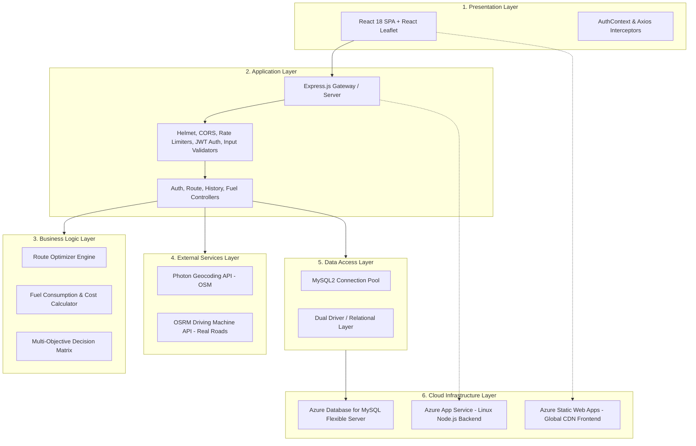

# RouteWise – System Design & Architecture Specification

## 1. Executive Summary & Objective

**RouteWise** is a full-stack smart route planning and optimization system designed for academic evaluation in **BTech CSE (Artificial Intelligence & Machine Learning)**. The system enables users to find, visualize, and compare real driving routes between geographical points, evaluating routes according to multi-objective criteria:
- **Fastest Route** (Minimized travel duration)
- **Shortest Route** (Minimized driving distance in km)
- **Cheapest Route** (Minimized vehicle fuel expense in ₹)
- **Recommended Route** (Optimal multi-criteria trade-off)

---

## 2. 6-Tier Layered Architecture

The application adopts a decoupled, modular 6-tier architecture adhering to high cohesion and loose coupling principles:

---

## 3. Communication & Data Flow

1. **Geocoding Flow**:
   - User types an origin or destination address.
   - Client sends `GET /api/routes/search-location?q={query}` (debounced at 350ms).
   - Backend queries Photon Geocoding API (`https://photon.komoot.io`) and formats suggestions with exact Latitude and Longitude.

2. **Route Calculation & Optimization Flow**:
   - User initiates route planning with vehicle fuel specs (Mileage in km/L and Fuel Price in ₹/L).
   - Client sends `POST /api/routes/calculate` with coordinates and fuel settings.
   - Express queries the Open Source Routing Machine (OSRM) driving API (`https://router.project-osrm.org`) with `alternatives=true`.
   - OSRM computes actual driving turns, road segment distances, durations, and GeoJSON polyline coordinates.
   - The Business Logic Optimizer computes:
     $$\text{Fuel Required (Litres)} = \frac{\text{Distance (km)}}{\text{Vehicle Mileage (km/L)}}$$
     $$\text{Estimated Fuel Cost (INR)} = \text{Fuel Required} \times \text{Fuel Price per Litre}$$
   - Routes are evaluated across duration, distance, and fuel cost to assign `FASTEST`, `SHORTEST`, `CHEAPEST`, and `RECOMMENDED` badges.
   - If the user is authenticated, the search query and computed routes are persisted in MySQL.

3. **Map Rendering Flow**:
   - React Leaflet renders OpenStreetMap base tiles.
   - Origin (Green Pin A) and Destination (Red Pin B) markers are plotted.
   - GeoJSON polylines for each route alternative are drawn. The active route is highlighted in glowing emerald green (`#10B981`); alternative routes are rendered in dashed slate/blue (`#64748B`).
   - Clicking any route card or polyline dynamically focuses the route and updates bounds.

---

## 4. Architectural Quality Attributes

| Quality Attribute | Architectural Tactic | Implementation |
| :--- | :--- | :--- |
| **Maintainability** | Layered separation & single responsibility | Clear directory boundaries: `config/`, `controllers/`, `services/`, `middleware/`, `routes/`. |
| **Scalability** | Stateless application server & connection pooling | Stateless JWT authentication enables horizontal scaling across Azure App Service instances without sticky sessions. |
| **Security** | Defense-in-depth | Helmet CSP headers, CORS whitelist, bcrypt password hashing, parameterized SQL queries, express-rate-limit. |
| **Reliability** | Resilient database driver & graceful degradation | Dual-mode database layer that supports live MySQL80 / Azure Database for MySQL Flexible Server while maintaining seamless local availability. |
| **Extensibility** | Open API interfaces | Easy integration of traffic congestion layers, toll calculators, or electric vehicle (EV) charging stations. |
