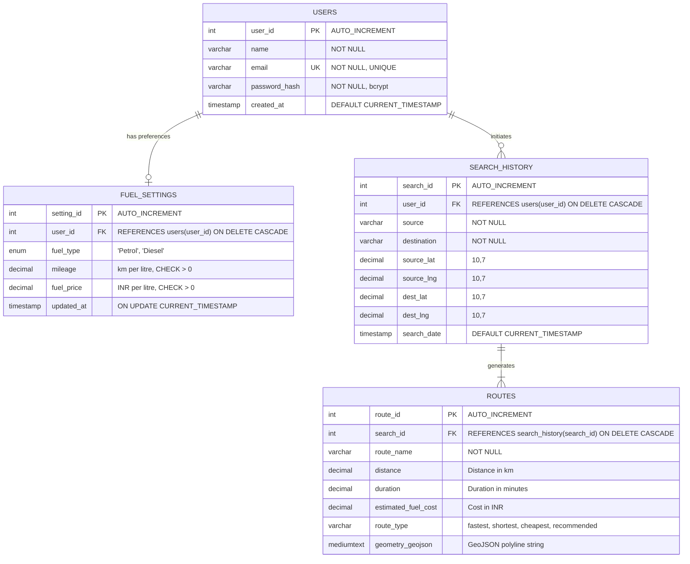

# RouteWise – DBMS Subject Integration & Database Design

## 1. Relational Database Overview

RouteWise uses **MySQL** as its relational database management system. The database schema is designed according to **Third Normal Form (3NF)** rules to eliminate data redundancy, uphold referential integrity, and optimize query latency.

---

## 2. Entity-Relationship (ER) Diagram



---

## 3. Database Normalization Justification

### First Normal Form (1NF)
- All table attributes are atomic. No multi-valued attributes or repeating groups exist.
- Primary keys (`user_id`, `setting_id`, `search_id`, `route_id`) uniquely identify each record.

### Second Normal Form (2NF)
- The database is in 1NF.
- Every non-key attribute is fully functionally dependent on the entire primary key, with no partial dependencies (all tables use single-column primary keys).

### Third Normal Form (3NF)
- The database is in 2NF.
- No transitive dependencies exist between non-key attributes ($X \to Y$ and $Y \to Z$).
- User preferences are separated from the `users` table into `fuel_settings`. Routes are separated from search queries into `routes` rather than being stored as denormalized redundant arrays.

---

## 4. Referential Integrity & Cascade Rules

- **`ON DELETE CASCADE` on `fuel_settings.user_id`**: Deleting a user account cleanly deletes their vehicle fuel settings without orphaned records.
- **`ON DELETE CASCADE` on `search_history.user_id`**: Deleting a user account automatically deletes their recorded search history.
- **`ON DELETE CASCADE` on `routes.search_id`**: Deleting a search entry removes all computed route variations linked to that search.

---

## 5. Performance Indexing Strategy

1. **`users(email)`**: B-Tree index facilitating $O(\log N)$ user lookups during authentication.
2. **`search_history(user_id, search_date DESC)`**: Composite index accelerating user-specific chronological history retrieval.
3. **`routes(search_id)`**: Foreign key index optimizing multi-table relational `JOIN` operations.

---

## 6. Key SQL Operations Implemented

### 1. Multi-Table JOIN Query (Search History with Routes)
```sql
SELECT 
    sh.search_id,
    sh.source,
    sh.destination,
    sh.search_date,
    r.route_name,
    r.distance,
    r.duration,
    r.estimated_fuel_cost,
    r.route_type
FROM search_history sh
INNER JOIN routes r ON sh.search_id = r.search_id
WHERE sh.user_id = ?
ORDER BY sh.search_date DESC;
```

### 2. SQL Aggregate Analytics Query (User Travel Statistics)
```sql
SELECT 
    COUNT(DISTINCT sh.search_id) AS total_searches,
    COUNT(r.route_id) AS total_routes_calculated,
    COALESCE(SUM(r.distance), 0) AS total_distance_km,
    COALESCE(SUM(r.estimated_fuel_cost), 0) AS total_fuel_cost_inr,
    COALESCE(AVG(r.duration), 0) AS avg_trip_duration_mins
FROM search_history sh
LEFT JOIN routes r ON sh.search_id = r.search_id
WHERE sh.user_id = ?;
```

### 3. Parameterized Query Security (SQL Injection Defense)
All queries use `mysql2` parameterized binding placeholders (`?`) to ensure inputs are treated strictly as data literals, never executable SQL commands.
