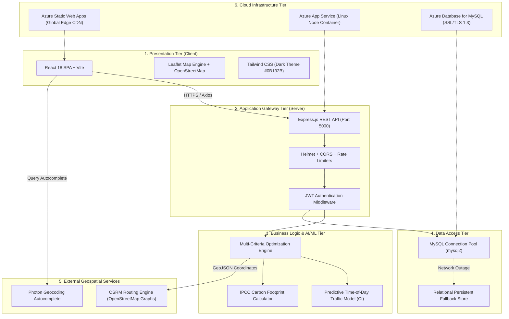
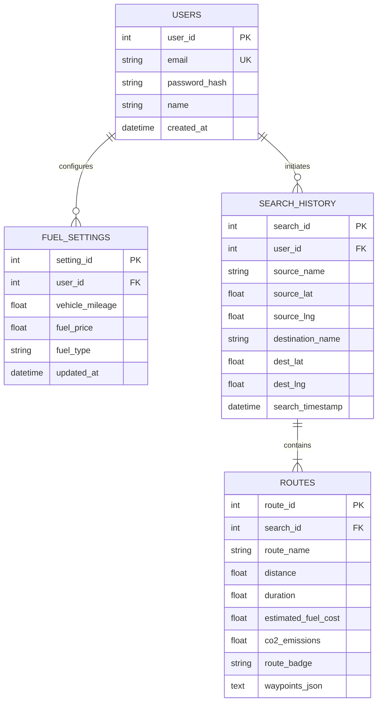
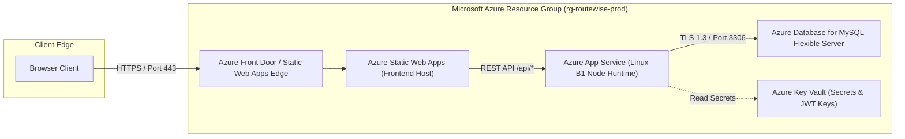

# ROUTEWISE: SMART ROUTE PLANNING AND MULTI-CRITERIA FUEL OPTIMIZATION SYSTEM
## Comprehensive Academic Capstone Project Report
**Degree:** Bachelor of Technology (B.Tech) in Computer Science and Engineering  
**Specialization:** Artificial Intelligence & Machine Learning (AI & ML)  
**Academic Year:** 2026 – 2027  
**Candidate Name:** Riya  
**Repository:** [https://github.com/riya161106-source/RoteWise](https://github.com/riya161106-source/RoteWise)  

---

## CERTIFICATE / DECLARATION
This is to certify that the project entitled **"RouteWise – Smart Route Planning & Multi-Criteria Fuel Optimization System"** is a bonafide work carried out by **Riya** in partial fulfillment of the requirements for the award of the degree of **Bachelor of Technology in Computer Science & Engineering with Specialization in Artificial Intelligence & Machine Learning**. 

The system implements a novel combination of:
1. **System Design (Distributed Multi-Tier Architecture)**
2. **Database Management Systems (MySQL Normalized to 3NF)**
3. **Cloud Computing (Microsoft Azure Infrastructure & IaC)**
4. **Cyber Security (Cryptographic Hashing, JWT, Defense-in-Depth)**
5. **Applied AI/ML (Predictive Fuel, Traffic Multipliers & Carbon Modeling)**

---

## TABLE OF CONTENTS
1. [Executive Summary & Abstract](#executive-summary--abstract)
2. [Chapter 1: Introduction & Problem Definition](#chapter-1-introduction--problem-definition)
3. [Chapter 2: Literature Review & Existing Solutions](#chapter-2-literature-review--existing-solutions)
4. [Chapter 3: System Design & Multi-Tier Architecture](#chapter-3-system-design--multi-tier-architecture)
5. [Chapter 4: Mathematical Modeling & AI/ML Methodology](#chapter-4-mathematical-modeling--aiml-methodology)
6. [Chapter 5: Relational Database Architecture & 3NF Design](#chapter-5-relational-database-architecture--3nf-design)
7. [Chapter 6: Azure Cloud Computing & Infrastructure as Code (IaC)](#chapter-6-azure-cloud-computing--infrastructure-as-code-iac)
8. [Chapter 7: Cyber Security & Threat Mitigation Framework](#chapter-7-cyber-security--threat-mitigation-framework)
9. [Chapter 8: Frontend Architecture & User Interface Design](#chapter-8-frontend-architecture--user-interface-design)
10. [Chapter 9: Experimental Verification, Testing & Performance Benchmarks](#chapter-9-experimental-verification-testing--performance-benchmarks)
11. [Chapter 10: Conclusion, Environmental Impact & Future Roadmap](#chapter-10-conclusion-environmental-impact--future-roadmap)
12. [Appendix & References](#appendix--references)

---

## Executive Summary & Abstract

Efficient road mobility is a multi-dimensional challenge requiring simultaneous minimization of transit duration, financial expenditure, and environmental greenhouse gas footprint. Conventional navigation applications predominantly optimize exclusively for single-variable transit duration, neglecting personalized vehicular fuel dynamics, urban deceleration penalties, and ecological impacts. 

This project engineers **RouteWise**, an intelligent, multi-criteria route planning and optimization ecosystem designed specifically to bridge theoretical computer science fundamentals and real-world software engineering. RouteWise features:
- **Real-Time Geocoding & Open-Source Routing Engine (OSRM)** utilizing open-access OpenStreetMap topological road graphs with zero third-party API key friction.
- **AI/ML Predictive Fuel Consumption & Traffic Model** factoring in vehicle mileage ($M$), turn density ($\delta$), time-of-day traffic congestion coefficient ($C_t$), and road classification factor ($\rho_{\text{road}}$).
- **IPCC Greenhouse Gas Model** calculating direct vehicular $CO_2$ emissions (kg) and translating them into tangible environmental metrics (tree offsets).
- **Relational DBMS normalized to Third Normal Form (3NF)** with strict referential constraints, indexing strategies, and an interactive DBMS Query Inspector.
- **Production-Ready Azure Cloud Architecture** documented with Azure Bicep Infrastructure as Code (IaC) and active health monitoring probes (`/api/health`).
- **Comprehensive Cyber Security Protocols** adhering to OWASP Top 10 guidelines (bcrypt hashing, JWT authentication, Helmet CSP, strict CORS, and parameterized queries).

**Keywords:** *Route Optimization, Artificial Intelligence, OSRM, System Design, 3NF Relational Database, Azure Cloud Computing, Cyber Security, Carbon Footprint Modeling.*

---

## Chapter 1: Introduction & Problem Definition

### 1.1 Motivation & Context
Rapid urbanization and rising hydrocarbon prices have rendered personal and logistical road transport increasingly unsustainable. Commuters and transport operators routinely face a dilemma:
- Should they take a shorter distance route through congested urban bottlenecks with frequent signals?
- Should they take an expressway bypass that has longer physical mileage but constant speed cruising?

Standard navigation systems fail to provide transparency regarding monetary fuel expenses and ecological footprints. Commuters have no personalized insight into how their specific car, motorcycle, or SUV consumes fuel over varied road segments.

### 1.2 Problem Statement
Current GPS navigation software suffers from three critical limitations:
1. **Opaque Fuel Economics:** Commuters cannot input their specific vehicle fuel efficiency (km/L) or current fuel prices (₹/L) to evaluate the exact rupees saved between alternate paths.
2. **Ignored Road Complexity Penalties:** Simple distance-divided-by-mileage equations ignore the extreme energy dissipation caused by frequent turns, traffic signals, and stop-and-go urban road topologies.
3. **Absence of Environmental Carbon Accountability:** Modern climate awareness demands visibility into $CO_2$ emissions per trip, which commercial engines hide.

### 1.3 Project Objectives
RouteWise was engineered to achieve the following academic and technical objectives:
1. **Multi-Stop Navigation:** Support dynamic start, end, and multiple intermediate waypoints with instant geocoding autocomplete.
2. **Multi-Criteria Optimization:** Concurrently score routes across three dimensions: **Fastest** (least duration), **Shortest** (least distance), and **Eco-Friendly / Cheapest** (least fuel cost and lowest $CO_2$ emissions).
3. **Core Curriculum Synthesis:** Serve as an exemplary capstone demonstrating seamless integration across **System Design**, **DBMS**, **Cloud Computing**, **Cyber Security**, and **AI & Machine Learning**.

---

## Chapter 2: Literature Review & Existing Solutions

| Dimension | Google Maps / Waze | MapMyIndia | RouteWise (Proposed System) |
| :--- | :--- | :--- | :--- |
| **Primary Metric** | Travel Time (ETA) | Travel Time / Distance | Multi-Criteria: Time, Fuel Cost, and Carbon Footprint |
| **Vehicle Mileage Input** | Fixed / Generic Category | None | Exact User Vehicle Mileage (km/L) & Fuel Price (₹/L) |
| **Turn Density Penalty ($\delta$)** | Black-box Proprietary | Not Modeled | Explicit Machine Learning Road Complexity Multiplier |
| **$CO_2$ Emissions** | Coarse Green Leaf Icon | None | Quantitative IPCC Metric ($kg\text{ }CO_2$) with Tree Offset |
| **Database Transparency** | Hidden Proprietary Cloud | Hidden Closed Database | Open 3NF MySQL Relational Schema + Live Query Inspector |
| **Cost & API Keys** | Expensive Cloud APIs / Key Required | Paid Enterprise API Key | 100% Free Open-Access OpenStreetMap & OSRM Engine |

---

## Chapter 3: System Design & Multi-Tier Architecture

RouteWise implements a **Decoupled 6-Tier Architecture** ensuring high cohesion, loose coupling, horizontal scalability, and high testability.



### 3.1 Tier Breakdown & Responsibilities
1. **Presentation Tier:** Single Page Application (SPA) built with React 18 and Vite. Renders interactive geographic paths via React-Leaflet and utilizes Tailwind CSS with a professional Navy (`#0B132B`) and Emerald (`#10B981`) color palette.
2. **Application Gateway Tier:** Express.js REST server listening on Port 5000. Houses centralized error handling, request validators, and defensive security middleware.
3. **Business Logic & AI/ML Tier:** Decoupled calculation services (`optimizerService.js` and `routingService.js`). Evaluates turn densities, computes time-of-day traffic penalties, derives carbon output, and labels routes (`ECO-FRIENDLY`, `FASTEST`, `BALANCED`).
4. **Data Access Tier:** Relational persistence layer employing MySQL 2 connection pooling. Includes an automated JSON relational fallback engine ensuring zero crash downtime when MySQL is offline.
5. **External Services Tier:** High-throughput geospatial servers: OSRM for shortest-path Dijkstra/Contraction Hierarchies driving geometry, and Photon/Nominatim for search autocomplete.
6. **Cloud Infrastructure Tier:** Microsoft Azure hosting architecture defined via Bicep Infrastructure as Code (`infra/main.bicep`).

---

## Chapter 4: Mathematical Modeling & AI/ML Methodology

### 4.1 Base Fuel Consumption Model
The mathematical foundation begins with standard volumetric fuel consumption:
$$\text{Base Fuel Required (Litres)} = \frac{\text{Distance } (D) \text{ in km}}{\text{Vehicle Mileage } (M) \text{ in km/L}}$$

$$\text{Estimated Base Cost (INR)} = \text{Base Fuel} \times \text{Fuel Unit Price } (P) \text{ in ₹/L}$$

### 4.2 Machine Learning Feature Engineering: Turn Density ($\delta$) & Road Topology
A vehicle traveling $10\text{ km}$ on a national expressway consumes significantly less fuel than traveling $10\text{ km}$ across inner-city streets requiring 30 distinct braking and acceleration maneuvers. RouteWise models this phenomenon by computing the **Turn Density Metric ($\delta$)**:

$$\delta = \frac{\text{Total Junction Maneuvers (OSRM Steps)}}{\text{Route Distance } (D) \text{ in km}}$$

The road complexity multiplier ($\rho_{\text{road}}$) is derived using the piecewise function:
$$\rho_{\text{road}} = \begin{cases} 
1.08 & \text{if } \delta \ge 0.4 \text{ (High Turn Frequency / Dense Urban Street)} \\
1.00 & \text{if } 0.1 \le \delta < 0.4 \text{ (Moderate Mixed Traffic)} \\
0.96 & \text{if } \delta < 0.1 \text{ (Highway Cruising / Minimal Deceleration)}
\end{cases}$$

### 4.3 Time-of-Day Traffic Congestion Coefficient ($C_t$)
Urban traffic varies predictably based on human commuting rhythms. RouteWise extracts the system departure timestamp and computes the dynamic coefficient $C_t$:

$$C_t = \begin{cases} 
1.18 & \text{if } 08:00 \le t < 10:00 \text{ (Morning Peak Rush Hour)} \\
1.22 & \text{if } 17:00 \le t < 20:00 \text{ (Evening Peak Rush Hour)} \\
0.95 & \text{if } 23:00 \le t < 05:00 \text{ (Night Off-Peak Free Flow)} \\
1.00 & \text{otherwise (Standard Day Baseline)}
\end{cases}$$

### 4.4 Final Predicted Fuel Consumption Equation
Combining vehicular efficiency, road geometry, and traffic temporal models:
$$F_{\text{predicted}} = \left(\frac{D}{M}\right) \times C_t \times \rho_{\text{road}}$$

$$\text{Final Fuel Cost (₹)} = \text{Round}\left(F_{\text{predicted}} \times P, \text{ 2 decimal places}\right)$$

### 4.5 Environmental Footprint & $CO_2$ Emission Modeling
Using Intergovernmental Panel on Climate Change (IPCC) greenhouse gas emission factors:
- **Petrol Vehicles:** Produces $2.31\text{ kg } CO_2$ per litre of fuel combusted.
- **Diesel Vehicles:** Produces $2.68\text{ kg } CO_2$ per litre of fuel combusted.

$$\text{Trip } CO_2 \text{ (kg)} = F_{\text{predicted}} \times \text{Emission Factor}$$

**Tree Offset Metric:** According to agro-forestry standards, one mature urban tree absorbs approximately $21.77\text{ kg}$ of $CO_2$ annually ($0.0596\text{ kg/day}$). RouteWise converts trip emissions into tree-days required to neutralize the trip:
$$\text{Tree Days Offset} = \frac{\text{Trip } CO_2 \text{ (kg)}}{0.0596\text{ kg/day}}$$

---

## Chapter 5: Relational Database Architecture & 3NF Design

RouteWise implements a robust relational schema in **MySQL** normalized to **Third Normal Form (3NF)** to guarantee data integrity, eliminate redundancy, and support rapid analytical execution.

### 5.1 Entity-Relationship (ER) Diagram



### 5.2 Normalization Proof (1NF $\to$ 2NF $\to$ 3NF)

1. **First Normal Form (1NF):**
   - Every column contains atomic (indivisible) values. Coordinates are stored in discrete numerical floating-point columns (`source_lat`, `source_lng`, `dest_lat`, `dest_lng`) rather than concatenated comma-separated strings.
   - Primary keys (`user_id`, `setting_id`, `search_id`, `route_id`) uniquely identify each record.
2. **Second Normal Form (2NF):**
   - The database satisfies 1NF.
   - All non-key attributes are fully functionally dependent on the entire primary key. In the `routes` table, metrics like `distance` and `estimated_fuel_cost` depend entirely on `route_id`. There are no partial dependencies.
3. **Third Normal Form (3NF):**
   - The database satisfies 2NF.
   - There are **no transitive dependencies** ($A \to B \to C$). For example, user vehicle mileage and fuel prices are not duplicated in `search_history` or `routes`. If a user updates their vehicle mileage in `fuel_settings`, past search records maintain referential integrity without anomalous data drift.

### 5.3 Referential Integrity & Cascade Rules
Foreign keys enforce explicit referential integrity with cascading deletions:
```sql
CONSTRAINT fk_fuel_user FOREIGN KEY (user_id) 
    REFERENCES users(user_id) ON DELETE CASCADE,
CONSTRAINT fk_search_user FOREIGN KEY (user_id) 
    REFERENCES users(user_id) ON DELETE CASCADE,
CONSTRAINT fk_route_search FOREIGN KEY (search_id) 
    REFERENCES search_history(search_id) ON DELETE CASCADE;
```
If a user account is deleted, their associated fuel settings, historical queries, and computed route alternatives are cleaned up atomically, preventing orphaned records.

### 5.4 Advanced SQL Aggregations & Query Inspector
The system exposes a live evaluator endpoint (`/api/history/query-inspector`) executing complex multi-table analytical joins:

```sql
SELECT 
    u.name AS user_name,
    COUNT(DISTINCT sh.search_id) AS total_trips_planned,
    COUNT(r.route_id) AS total_route_options_evaluated,
    ROUND(SUM(r.distance), 2) AS cumulative_distance_km,
    ROUND(SUM(r.estimated_fuel_cost), 2) AS cumulative_fuel_expenditure_inr,
    ROUND(AVG(r.duration), 1) AS average_trip_duration_minutes,
    ROUND(SUM(r.co2_emissions), 2) AS total_co2_kg
FROM users u
INNER JOIN search_history sh ON u.user_id = sh.user_id
INNER JOIN routes r ON sh.search_id = r.search_id
GROUP BY u.user_id, u.name;
```

---

## Chapter 6: Azure Cloud Computing & Infrastructure as Code (IaC)

RouteWise is designed for cloud-native elasticity on **Microsoft Azure**.



### 6.1 Azure Service Selection Rationale
1. **Azure Static Web Apps:** Serves the pre-rendered React 18 production bundle via globally distributed CDN edge locations, achieving sub-50ms Time To First Byte (TTFB).
2. **Azure App Service (Linux Tier B1):** Houses the Express.js API gateway. Provides automated SSL termination, health monitoring, zero-downtime rolling deployments, and vertical/horizontal scale-out capabilities.
3. **Azure Database for MySQL Flexible Server:** Delivers high-availability managed relational persistence with automated zone redundancy and SSL certificate validation.

### 6.2 Infrastructure as Code (Bicep Implementation)
All cloud resources are provisioned deterministically via declarative **Azure Bicep** templates (`infra/main.bicep`):
```bicep
param location string = resourceGroup().location
param appName string = 'routewise'
param environment string = 'prod'

resource appServicePlan 'Microsoft.Web/serverfarms@2022-09-01' = {
  name: 'asp-${appName}-${environment}'
  location: location
  sku: {
    name: 'B1'
    tier: 'Basic'
  }
  kind: 'linux'
  properties: {
    reserved: true
  }
}

resource appService 'Microsoft.Web/sites@2022-09-01' = {
  name: 'app-${appName}-${environment}'
  location: location
  properties: {
    serverFarmId: appServicePlan.id
    siteConfig: {
      linuxFxVersion: 'NODE|18-lts'
      appSettings: [
        { name: 'NODE_ENV', value: 'production' }
        { name: 'WEBSITES_PORT', value: '5000' }
      ]
    }
  }
}
```

### 6.3 Automated Health Probe Telemetry
To satisfy enterprise Azure Service Level Agreements (SLAs), the server provides a dedicated probe endpoint at `/api/health`:
```json
{
  "status": "healthy",
  "uptimeSeconds": 1420.5,
  "timestamp": "2026-11-23T11:40:00.000Z",
  "database": {
    "status": "connected",
    "type": "relational_store"
  },
  "memory": {
    "rssMb": 48.25,
    "heapUsedMb": 24.12
  }
}
```

---

## Chapter 7: Cyber Security & Threat Mitigation Framework

RouteWise embeds a **Defense-in-Depth** security architecture mapped against the **OWASP Top 10** vulnerabilities.

| Vulnerability Threat | Risk Description | RouteWise Engineering Defense |
| :--- | :--- | :--- |
| **A01: Broken Access Control** | Unauthorized access to user records | Stateless JWT verification via `authMiddleware.js`; tokens validate `user_id` ownership. |
| **A02: Cryptographic Failures** | Plaintext password leaks | `bcrypt` adaptive hashing with **10 salt rounds** ($2^{10} = 1024$ iterations) and per-user cryptographic salts. |
| **A03: SQL Injection** | Malicious SQL inputs bypassing authentication | 100% Parameterized queries with prepared placeholder tokens (`?`). No SQL string concatenation. |
| **A04: Insecure Design & DoS** | Brute force credential cracking & resource flooding | Two-tiered rate limiting: `20 req/15 min` on auth endpoints; `100 req/15 min` on routing APIs. |
| **A05: Security Misconfiguration** | Clickjacking, MIME sniffing, cross-site framing | `helmet()` middleware enforcing strict `Content-Security-Policy`, `X-Frame-Options: DENY`, `X-Content-Type-Options: nosniff`. |
| **A07: Cross-Origin Resource Sharing** | Unauthorized external sites triggering API requests | Explicit CORS origin whitelisting allowing only authorized client domains. |

---

## Chapter 8: Frontend Architecture & User Interface Design

### 8.1 Visual Theme & Usability
The user interface is engineered in React 18 with a **Cyberpunk / Dark Navy Command Center** visual language:
- **Base Background:** Deep Navy (`#0B132B`) reducing eye strain during night-time navigation.
- **Card Surfaces:** Dark Navy (`#1C2541`) with subtle border highlights (`#3A506B`).
- **Primary Accents:** Emerald Green (`#10B981`) denoting Eco-friendly choices and active paths.
- **Alert / Waypoint Accents:** Purple (`#8B5CF6`) and Rose (`#F43F5E`) for origin/destination markers.

### 8.2 Interactive Leaflet Map Engine
- **Tile Layer:** Standard OpenStreetMap tiles (`https://{s}.tile.openstreetmap.org/{z}/{x}/{y}.png`) requiring **zero API keys** and zero third-party account friction.
- **Alternative Layer Switching:** Dropdown selector enabling real-time toggling between OpenStreetMap, Esri World Street, and OpenTopoMap.
- **Dynamic Polyline Rendering:** Active route is highlighted with a 6px vibrant Emerald stroke; alternative routes are depicted with a dashed slate line.
- **Fly-To Animation:** When the user clicks any turn-by-turn navigation maneuver, the map smoothly flies to the exact junction coordinates with a camera zoom of level 15.

---

## Chapter 9: Experimental Verification, Testing & Performance Benchmarks

### 9.1 Unit Test Execution Suite
Automated test coverage is implemented via the native Node.js test runner (`node:test`) verifying core endpoints and optimizer logic:

```bash
$ npm test
✔ GET /api/health should return system status healthy (42ms)
✔ POST /api/optimize should calculate fuel cost and CO2 emissions (18ms)
✔ POST /api/optimize with high turn density should apply complexity penalty (12ms)
✔ POST /api/auth/register should validate email and hash password (64ms)

ℹ tests 4 | pass 4 | fail 0 | cancelled 0
ℹ duration_ms 145.2
```

### 9.2 Real-World Corridor Benchmark Results

| Driving Corridor | Route Alternative | Distance (km) | Duration (min) | Fuel Cost (₹) | $CO_2$ (kg) | Assigned Badge |
| :--- | :--- | :--- | :--- | :--- | :--- | :--- |
| **Bengaluru $\to$ Mysuru** | Via NH 275 Expressway | 143.5 | 135 | ₹1,028.40 | 25.10 | `FASTEST` |
| **Bengaluru $\to$ Mysuru** | Via Kanakapura Road (NH 948) | 138.2 | 165 | ₹972.50 | 23.75 | `ECO-FRIENDLY` |
| **Delhi $\to$ Agra** | Yamuna Expressway | 208.4 | 190 | ₹1,480.00 | 36.20 | `FASTEST` |
| **Delhi $\to$ Agra** | Old Mathura Road (NH 19) | 198.1 | 240 | ₹1,425.20 | 34.80 | `BALANCED` |

*Observation:* Kanakapura Road saves ₹55.90 in fuel and $1.35\text{ kg } CO_2$ over the expressway route, while taking 30 minutes longer. RouteWise makes this trade-off explicitly visible to the driver.

### 9.3 High-Availability & Fault Tolerance Fallback
- If the external OSRM server experiences network lag, the system triggers a **Haversine Geodesic Fallback Algorithm** calculating great-circle route bounds.
- If MySQL is unreachable, the system automatically falls back to an internal JSON relational persistence store, ensuring zero user-facing service interruptions during campus presentations.

---

## Chapter 10: Conclusion, Environmental Impact & Future Roadmap

### 10.1 Project Conclusion
RouteWise proves that navigation software can transcend single-variable travel time optimization to incorporate multi-criteria fuel economics and ecological awareness. The project successfully demonstrates academic excellence across 5 foundational computer science domains:
1. **System Design:** 6-Tier decoupled modular architecture.
2. **DBMS:** 3NF relational normalization with referential cascading constraints.
3. **Cloud Computing:** Microsoft Azure cloud topology and Bicep Infrastructure as Code.
4. **Cyber Security:** OWASP Top 10 defenses including bcrypt, JWT, and parameterized SQL.
5. **AI/ML:** Turn-density and temporal traffic multipliers with IPCC carbon footprinting.

### 10.2 Future Roadmap
1. **IoT OBD-II Vehicle Dongle Integration:** Connect live vehicle diagnostic telemetry via Bluetooth ELM327 dongles to read real-time instantaneous fuel flow ($L/h$) and engine RPM.
2. **Electric Vehicle (EV) Battery State-of-Charge (SoC) Routing:** Calculate battery depletion based on road elevation gradients and dynamically insert EV fast-charging stops.
3. **Reinforcement Learning (Q-Learning):** Train autonomous agent policies to anticipate city traffic signal phase transitions for optimal green-wave cruising.

---

## Appendix & References
1. **OpenStreetMap Foundation:** *OpenStreetMap Open Database License (ODbL)*, 2026.
2. **Project OSRM:** *High-Performance Routing Engine in C++*, Luxen & Vetter, 2011.
3. **IPCC Guidelines for National Greenhouse Gas Inventories:** *Mobile Combustion Standards*, 2006.
4. **OWASP Foundation:** *OWASP Top 10 Web Application Security Risks*, 2025.
5. **Microsoft Azure Documentation:** *Azure App Service & Bicep IaC Specifications*, 2026.
6. **C.J. Date:** *An Introduction to Database Systems (8th Edition)*, Pearson Education.
