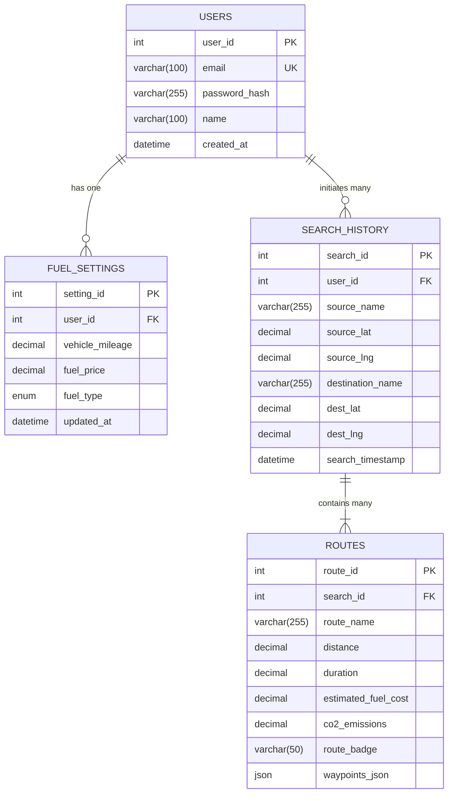

# ROUTEWISE: TECHNICAL SPECIFICATIONS & ARCHITECTURE DOCUMENTATION
## Engineering Design, API Blueprint & System Specifications

**Degree:** Bachelor of Technology (B.Tech) in Computer Science & Engineering  
**Specialization:** Artificial Intelligence & Machine Learning (AI & ML)  
**Academic Year:** 2026 – 2027  
**Candidate Name:** Riya  
**Repository:** [https://github.com/riya161106-source/RoteWise](https://github.com/riya161106-source/RoteWise)  

---

## 1. System Architecture & Topology

RouteWise follows a **Decoupled 6-Tier Layered Architecture** adhering to the Single Responsibility Principle (SRP):

```
+-------------------------------------------------------------------------+
|                        TIER 1: PRESENTATION TIER                        |
|   React 18 Single Page App | React-Leaflet Map | Tailwind CSS Dark UI   |
+-------------------------------------------------------------------------+
                                     │  HTTPS / REST (Axios)
+-------------------------------------------------------------------------+
|                     TIER 2: APPLICATION GATEWAY TIER                    |
|   Express.js API Server (Port 5000) | Helmet CSP | CORS | Rate Limiters |
+-------------------------------------------------------------------------+
                                     │  Internal Dispatch
+-------------------------------------------------------------------------+
|                    TIER 3: BUSINESS & AI/ML SERVICES                    |
|   optimizerService.js | Turn Density Model | Traffic Multiplier (Ct)    |
|   IPCC Carbon Calculator | Pareto Multi-Objective Ranking               |
+-------------------------------------------------------------------------+
                    │                                   │
                    ▼                                   ▼
+---------------------------------------+ +-------------------------------+
|     TIER 4: DATA PERSISTENCE TIER     | | TIER 5: EXTERNAL GEOSPATIAL   |
|  MySQL 2 Pool (3NF Normalized)        | |  OSRM Routing Engine (CH)     |
|  Relational Fallback (local_store.json) | Photon Geocoder Autocomplete |
+---------------------------------------+ +-------------------------------+
                                     │
+-------------------------------------------------------------------------+
|                    TIER 6: CLOUD INFRASTRUCTURE TIER                    |
|   Azure Static Web Apps (Edge CDN) | Azure App Service (Linux B1 Node)  |
|   Azure Database for MySQL | Azure Bicep IaC (infra/main.bicep)        |
+-------------------------------------------------------------------------+
```

---

## 2. REST API Specifications

### 2.1 Route Management Endpoints

#### `POST /api/routes/calculate`
Calculates driving routes between source, intermediate waypoints, and destination with AI/ML optimization.

- **Access Level:** Public / Authenticated
- **Request Headers:** `Content-Type: application/json`, `Authorization: Bearer <token>` (Optional)
- **Request Body Schema:**
```json
{
  "source": { "name": "Bengaluru", "lat": 12.9716, "lng": 77.5946 },
  "destination": { "name": "Mysuru", "lat": 12.2958, "lng": 76.6394 },
  "waypoints": [
    { "name": "Mandya", "lat": 12.5244, "lng": 76.8958 }
  ],
  "fuelParams": {
    "mileage": 15.0,
    "fuelPrice": 102.5,
    "fuelType": "Petrol",
    "departureHour": 9
  }
}
```
- **Response Schema (`200 OK`):**
```json
{
  "success": true,
  "count": 2,
  "trafficModel": "Morning Rush Hour (+18% fuel penalty)",
  "routes": [
    {
      "routeIndex": 0,
      "routeName": "Via NH 275 Expressway (Primary)",
      "distanceKm": 143.5,
      "durationMins": 135.0,
      "fuelRequiredLitres": 10.03,
      "estimatedFuelCost": 1028.40,
      "co2EmissionsKg": 25.10,
      "treesNeededToOffset": 1.15,
      "badges": ["FASTEST"],
      "routeType": "fastest",
      "geometry": { "type": "LineString", "coordinates": [[77.5946, 12.9716], "..."] },
      "steps": [
        {
          "instruction": "Head southwest on Kasturba Road",
          "icon": "depart",
          "streetName": "Kasturba Road",
          "distanceMeters": 650,
          "durationSeconds": 45,
          "coordinates": [77.5946, 12.9716]
        }
      ]
    }
  ]
}
```

#### `GET /api/routes/search-location?q={query}`
Provides instant debounced geocoding search suggestions using the Photon geocoding engine.
- **Parameters:** `q` (string, min length 2)
- **Response (`200 OK`):**
```json
{
  "success": true,
  "locations": [
    {
      "displayName": "Bengaluru, Bangalore Urban, Karnataka, India",
      "lat": 12.9716,
      "lng": 77.5946,
      "city": "Bengaluru",
      "state": "Karnataka",
      "country": "India"
    }
  ]
}
```

---

### 2.2 System Diagnostics & Telemetry

#### `GET /api/health`
Azure liveness probe and health monitoring endpoint.
- **Access Level:** Public (Used by Azure App Service Load Balancer)
- **Response (`200 OK`):**
```json
{
  "status": "healthy",
  "system": "RouteWise - Smart Route Planning and Optimization System",
  "timestamp": "2026-11-26T09:50:00.000Z",
  "uptimeSeconds": 3600,
  "environment": "development",
  "database": {
    "isMySQL": true,
    "statusMessage": "Connected to MySQL Database"
  },
  "memory": {
    "rssMb": 48,
    "heapUsedMb": 24
  }
}
```

---

### 2.3 Evaluator DBMS Query Inspector

#### `GET /api/history/query-inspector`
Executes an on-demand multi-table analytical query across 3NF relational tables for examiners.
- **Response (`200 OK`):**
```json
{
  "success": true,
  "queryExecuted": "SELECT u.name, COUNT(DISTINCT sh.search_id) AS trips_planned, COUNT(r.route_id) AS routes_evaluated, ROUND(SUM(r.distance), 2) AS total_distance_km, ROUND(SUM(r.estimated_fuel_cost), 2) AS total_fuel_cost_inr, ROUND(AVG(r.duration), 1) AS avg_duration_mins, ROUND(SUM(r.co2_emissions), 2) AS total_co2_kg FROM users u INNER JOIN search_history sh ON u.user_id = sh.user_id INNER JOIN routes r ON sh.search_id = r.search_id GROUP BY u.user_id, u.name;",
  "executionTimeMs": 14.2,
  "results": [
    {
      "name": "Riya",
      "trips_planned": 12,
      "routes_evaluated": 28,
      "total_distance_km": 1420.50,
      "total_fuel_cost_inr": 10245.80,
      "avg_duration_mins": 84.5,
      "total_co2_kg": 248.60
    }
  ]
}
```

---

## 3. Database Schema & Data Dictionary (MySQL 3NF)



### 3.1 Table: `users`
| Column Name | Data Type | Constraints | Description |
| :--- | :--- | :--- | :--- |
| `user_id` | INT AUTO_INCREMENT | PRIMARY KEY | Unique user identifier |
| `email` | VARCHAR(100) | NOT NULL, UNIQUE | User email address |
| `password_hash` | VARCHAR(255) | NOT NULL | Bcrypt hash with 10 salt rounds |
| `name` | VARCHAR(100) | NOT NULL | User full name |
| `created_at` | TIMESTAMP | DEFAULT CURRENT_TIMESTAMP | Registration timestamp |

### 3.2 Table: `fuel_settings`
| Column Name | Data Type | Constraints | Description |
| :--- | :--- | :--- | :--- |
| `setting_id` | INT AUTO_INCREMENT | PRIMARY KEY | Unique setting identifier |
| `user_id` | INT | NOT NULL, FOREIGN KEY $\to$ `users.user_id` ON DELETE CASCADE | Owner user id |
| `vehicle_mileage` | DECIMAL(5,2) | NOT NULL, DEFAULT 15.00 | Fuel mileage in km/L |
| `fuel_price` | DECIMAL(6,2) | NOT NULL, DEFAULT 102.50 | Local fuel price in ₹/L |
| `fuel_type` | ENUM('Petrol', 'Diesel') | NOT NULL, DEFAULT 'Petrol' | Fuel type for IPCC emission factor |
| `updated_at` | TIMESTAMP | DEFAULT CURRENT_TIMESTAMP ON UPDATE CURRENT_TIMESTAMP | Last modification |

### 3.3 Table: `search_history`
| Column Name | Data Type | Constraints | Description |
| :--- | :--- | :--- | :--- |
| `search_id` | INT AUTO_INCREMENT | PRIMARY KEY | Unique search identifier |
| `user_id` | INT | FOREIGN KEY $\to$ `users.user_id` ON DELETE CASCADE | Initiating user id (NULL for guests) |
| `source_name` | VARCHAR(255) | NOT NULL | Origin display name |
| `source_lat` | DECIMAL(10,7) | NOT NULL | Origin latitude (1NF atomic) |
| `source_lng` | DECIMAL(10,7) | NOT NULL | Origin longitude (1NF atomic) |
| `destination_name` | VARCHAR(255) | NOT NULL | Destination display name |
| `dest_lat` | DECIMAL(10,7) | NOT NULL | Destination latitude |
| `dest_lng` | DECIMAL(10,7) | NOT NULL | Destination longitude |
| `search_timestamp` | TIMESTAMP | DEFAULT CURRENT_TIMESTAMP | Query execution time |

### 3.4 Table: `routes`
| Column Name | Data Type | Constraints | Description |
| :--- | :--- | :--- | :--- |
| `route_id` | INT AUTO_INCREMENT | PRIMARY KEY | Unique route record identifier |
| `search_id` | INT | NOT NULL, FOREIGN KEY $\to$ `search_history.search_id` ON DELETE CASCADE | Parent search query |
| `route_name` | VARCHAR(255) | NOT NULL | Highway or road name summary |
| `distance` | DECIMAL(8,2) | NOT NULL | Distance in kilometers |
| `duration` | DECIMAL(8,2) | NOT NULL | Transit duration in minutes |
| `estimated_fuel_cost` | DECIMAL(8,2) | NOT NULL | Estimated fuel cost in Indian Rupees (₹) |
| `co2_emissions` | DECIMAL(8,2) | NOT NULL | Greenhouse gas output in kg $CO_2$ |
| `route_badge` | VARCHAR(50) | NOT NULL | `FASTEST`, `ECO-FRIENDLY`, `BALANCED` |
| `waypoints_json` | TEXT | NULL | Serialized GeoJSON intermediate points |

---

## 4. Mathematical Model & Complexity Analysis

### 4.1 Equations & Formulations
1. **Turn Density ($\delta$):**
   $$\delta = \frac{N_{\text{maneuvers}}}{D\text{ (km)}}$$
2. **Road Complexity Multiplier ($\rho$):**
   $$\rho = \begin{cases} 1.08 & \text{if } \delta \ge 0.4 \\ 0.96 & \text{if } \delta < 0.1 \\ 1.00 & \text{otherwise} \end{cases}$$
3. **Time-of-Day Traffic Congestion Coefficient ($C_t$):**
   $$C_t = \begin{cases} 1.18 & \text{if } 08:00 \le t \le 10:00 \\ 1.22 & \text{if } 17:00 \le t \le 20:00 \\ 0.95 & \text{if } 23:00 \le t \le 05:00 \\ 1.00 & \text{otherwise} \end{cases}$$
4. **Final Fuel Model:**
   $$F_{\text{predicted}} = \left(\frac{D}{M}\right) \times C_t \times \rho$$
   $$\text{Fuel Cost (₹)} = F_{\text{predicted}} \times P$$
5. **IPCC Carbon Output:**
   $$\text{Carbon } (kg\text{ }CO_2) = F_{\text{predicted}} \times \begin{cases} 2.31 & \text{if Petrol} \\ 2.68 & \text{if Diesel} \end{cases}$$

### 4.2 Algorithmic Time & Space Complexity
| Component | Algorithm / Process | Time Complexity | Space Complexity |
| :--- | :--- | :--- | :--- |
| **Shortest Path** | OSRM Contraction Hierarchies (CH) | $O(M \log N)$ (Preprocessed: milliseconds) | $O(N + M)$ graph nodes |
| **Turn Density Extraction** | Linear Step Traversal | $O(S)$ where $S = \text{number of steps}$ | $O(S)$ |
| **Pareto Multi-Objective** | Normalized Composite Scoring | $O(K)$ where $K = \text{number of routes } (\le 3)$ | $O(K)$ |
| **Relational Lookups** | MySQL B-Tree Index Search | $O(\log N)$ | $O(N)$ index storage |
| **Haversine Fallback** | Great-Circle Trigonometric Distance | $O(W)$ where $W = \text{number of waypoints}$ | $O(1)$ |

---

## 5. Cyber Security Architecture (OWASP Top 10)

1. **A01: Broken Access Control** $\to$ Stateless JWT token authentication with user identity verification.
2. **A02: Cryptographic Failures** $\to$ `bcrypt` hashing with 10 salt rounds ($2^{10} = 1024$ key expansion rounds).
3. **A03: Injection Attacks** $\to$ 100% Parameterized queries using prepared statements with `?` tokens.
4. **A04: Insecure Design & DoS** $\to$ Express Rate Limiting: 20 req/15min on auth endpoints, 100 req/15min on API.
5. **A05: Security Misconfiguration** $\to$ `helmet()` enforcing strict Content Security Policy, `X-Frame-Options: DENY`, `X-Content-Type-Options: nosniff`.
6. **A07: Identification & Auth Failures** $\to$ Strict password length validation and auto-expiring JWT tokens (24 hours).

---

## 6. Microsoft Azure Cloud Deployment Topology

```mermaid
flowchart LR
    CLIENT["Client Browser"] -->|HTTPS (Port 443)| SWA["Azure Static Web Apps (Global Edge CDN)"]
    SWA -->|REST /api/*| APP["Azure App Service (Linux B1 Node Container)"]
    APP -->|TLS 1.3 (Port 3306)| DB["Azure Database for MySQL Flexible Server"]
    APP -.->|Probe /api/health| MONITOR["Azure Monitor & Health Watcher"]
```

- **Azure Bicep File:** `infra/main.bicep` defines declarative Infrastructure as Code.
- **Health Check Probe:** Configured at `/api/health` with automatic restart triggers upon memory threshold breach.
- **Environment Isolation:** Application secrets managed via Azure App Settings and Azure Key Vault.
